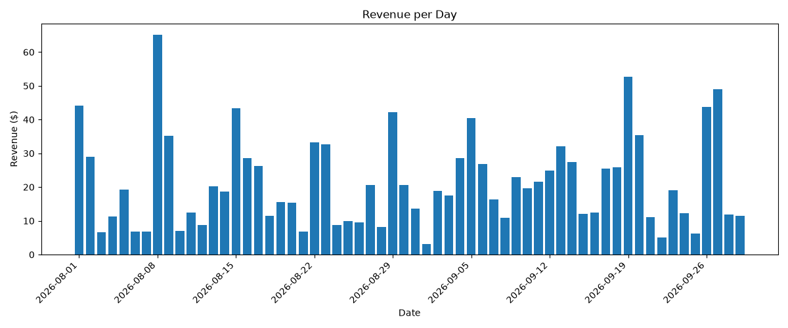
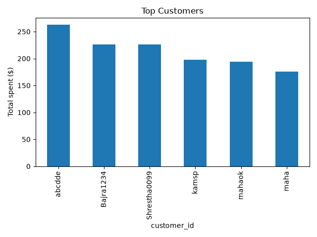
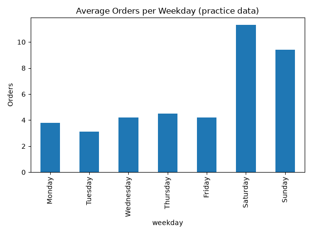

# Laundromat Management System
A Python-based laundromat management system with customer and order management, receipt generation, revenue analysis, and basic sales prediction.

## Project Background
This project started as one of my first-semester programming projects. Instead of leaving it as a classroom assignment, I decided to continue working on it and take the original idea further.
As I continued learning Python, I expanded the project by adding more functionality, including customer and order management, automatic receipt generation, business data analysis, visualizations, and basic revenue prediction.
This project represents my learning journey and how I have continued improving an idea by applying new programming concepts and skills.

## Features
- **Customer Management:** Manage customer information.
- **Order Management:** Create and track laundromat orders.
- **Receipt Generation:** Generate receipts for customer orders.
- **Revenue Tracking:** Calculate and monitor business revenue.
- **Daily Revenue Analysis:** Analyze revenue across different days.
- **Top Customer Analysis:** Identify customers based on their total spending.
- **Busy Day Analysis:** Identify the busiest weekdays.
- **Revenue Prediction:** Explore basic revenue forecasting.
- **Practice Data Generation:** Generate sample orders for testing and analysis.

## Technologies Used
- Python
- JSON
- Pandas
- Matplotlib

## Project Structure
| File | Description |
|---|---|
| `Laundromat_management_system_project.py` | Main laundromat management program |
| `analysis.py` | Analyzes customer orders and revenue |
| `predict.py` | Performs basic revenue prediction |
| `make_practice_data.py` | Generates practice order data |
| `practice_orders.json` | Sample data used for analysis |
| `daily_revenue.png` | Daily revenue visualization |
| `top_customers.png` | Top customer visualization |
| `busy_days.png` | Busiest weekdays visualization |

## Data Visualizations
The project uses Matplotlib to turn order data into visual reports.

### Daily Revenue
Shows how revenue changes from day to day.

### Top Customers
Shows customers ranked by their total spending.

### Busy Days
Shows which weekdays receive the most orders.

## How to Run
### 1. Install Python
Make sure Python 3 is installed on your computer.
### 2. Download the Repository
Clone the repository:
`git clone https://github.com/Priyamaharjan1/laundromat-management-system.git`
### 3. Install Required Libraries
`pip install pandas matplotlib`
### 4. Run the Main Program
`python Laundromat_management_system_project.py`
### 5. Run Data Analysis
`python analysis.py`
### 6. Run Revenue Prediction
`python predict.py`

## What I Learned
Working on this project helped me practice and improve my understanding of:
- Python programming and functions
- Working with JSON files
- Managing customer and order data
- Generating receipts
- Using Pandas for data analysis
- Creating charts with Matplotlib
- Understanding business revenue and customer patterns
- Developing and improving an existing project over time

## Future Improvements
- Improve revenue prediction accuracy.
- Add more detailed business reports.
- Improve the user interface.
- Expand customer and order management features.

---

**A project that started in my first semester and continued to grow as I learned more about programming.**
